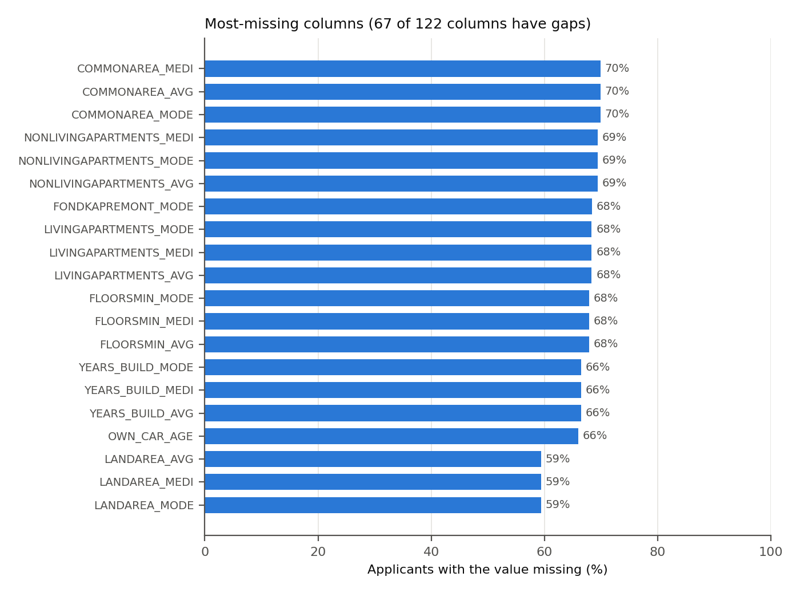
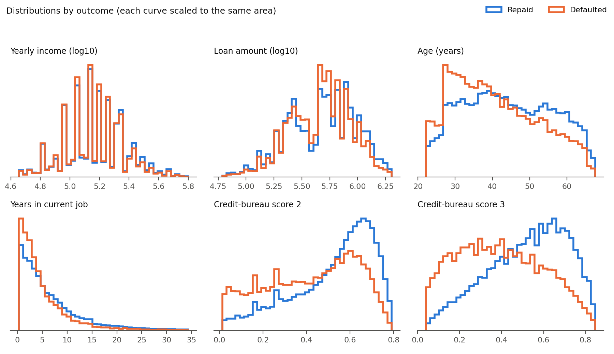
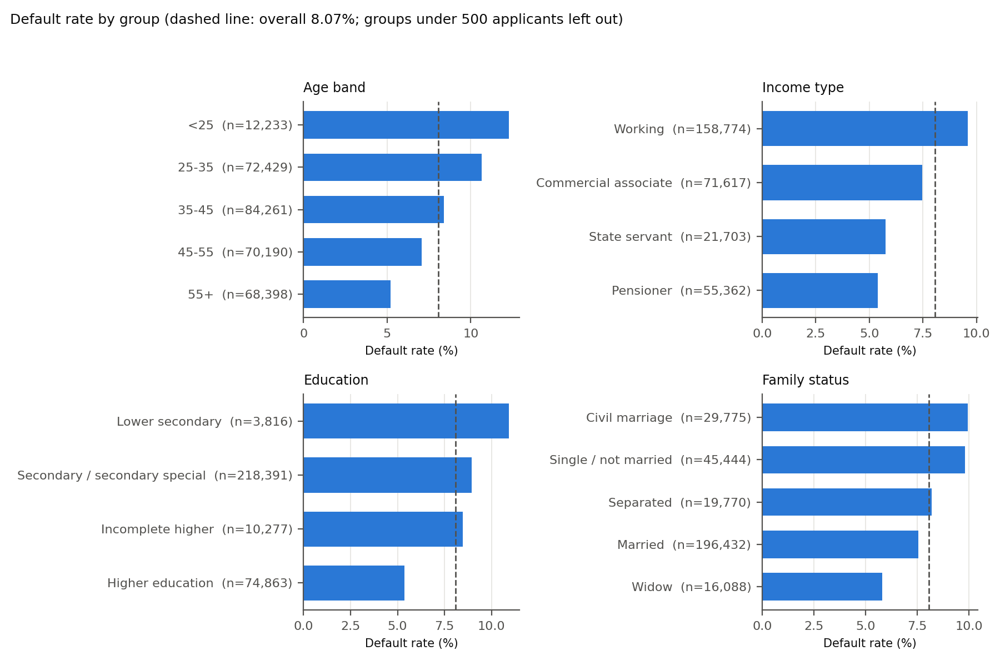

# Exploratory Data Analysis — Home Credit Default Risk

Generated by `src/eda.py` from `data/home_credit/application_train.csv`, the data as received, before cleaning.

## Dataset

- **307,511 applicants**, 122 columns (including the ID and the target).
- **Default rate 8.07%** (24,825 applicants with payment difficulties): a strongly imbalanced target.
- 106 numeric and 16 categorical columns.
- Ages 20.5–69.1 years, so there are no minors (see TECHNICAL_DECISIONS D-76).
- 55,374 applicants (18.01%) have the placeholder 365243 in `DAYS_EMPLOYED`; 99.96% of them are pensioners. Their default rate is 5.40%, against 8.66% for the rest.
- Split used by every model: stratified 80/20 train/test (`random_state=42`, src/train_baseline.py), then 80/20 fit/validation inside the training part for early stopping and cutoffs (src/final_model.py).

## Missing values

67 of 122 columns have missing values; 41 are missing for more than half of the applicants, mostly the building details (`*_AVG`, `*_MODE`, `*_MEDI`). The credit-bureau scores are missing for 56.38% (score 1), 0.21% (score 2) and 19.83% (score 3).

**What src/data_prep.py does:** the `DAYS_EMPLOYED` placeholder becomes a flag (`IS_EMPLOYED_ANOMALY`) and a missing value; numeric gaps are filled with the column median and categorical gaps with the most common value; non-binary numeric columns are clipped to the mean ± 3 standard deviations; bureau and previous-application aggregates are merged in, with 0 for applicants without records.

## Distributions by outcome

Defaulters have lower credit-bureau scores, are younger and have shorter job tenure; income and loan amount differ little between the two groups.

| Feature | Median, repaid | Median, defaulted |
|---|---|---|
| Yearly income | 148,500.00 | 135,000.00 |
| Loan amount | 517,788.00 | 497,520.00 |
| Age (years) | 43.47 | 39.10 |
| Years in current job | 4.63 | 3.37 |
| Credit-bureau score 2 | 0.57 | 0.44 |
| Credit-bureau score 3 | 0.55 | 0.38 |

## Default rate by group

- **Age band:** <25 12.29%, 25-35 10.66%, 35-45 8.41%, 45-55 7.05%, 55+ 5.22%
- **Income type:** Commercial associate 7.48%, Pensioner 5.39%, State servant 5.75%, Working 9.59%
- **Education:** Higher education 5.36%, Incomplete higher 8.48%, Lower secondary 10.93%, Secondary / secondary special 8.94%
- **Family status:** Civil marriage 9.94%, Married 7.56%, Separated 8.19%, Single / not married 9.81%, Widow 5.82%

The age pattern (default falling from 12.29% under 25 to 5.22% over 55) is what the model's age-band approval gap follows (`reports/age_fairness_experiment.json`).

## Numeric columns most related to default

Ranked by absolute Spearman correlation with the target, each over the applicants who have the value (full table in `top_correlations.csv`). `DAYS_*` columns count days before the application as negative numbers, so a positive sign means more recent: younger applicants, newer phone numbers and ID documents go with more defaults.

| Column | Spearman |
|---|---|
| `EXT_SOURCE_3` | -0.166 |
| `EXT_SOURCE_1` | -0.151 |
| `EXT_SOURCE_2` | -0.147 |
| `DAYS_BIRTH` | +0.078 |
| `REGION_RATING_CLIENT_W_CITY` | +0.061 |
| `REGION_RATING_CLIENT` | +0.059 |
| `DAYS_LAST_PHONE_CHANGE` | +0.054 |
| `OWN_CAR_AGE` | +0.053 |
| `DAYS_ID_PUBLISH` | +0.052 |
| `REG_CITY_NOT_WORK_CITY` | +0.051 |
| `FLOORSMAX_AVG` | -0.046 |
| `FLOORSMAX_MEDI` | -0.046 |
| `FLAG_EMP_PHONE` | +0.046 |
| `FLOORSMAX_MODE` | -0.045 |
| `REG_CITY_NOT_LIVE_CITY` | +0.044 |

The credit-bureau scores are by far the strongest single signals, as in the final model's SHAP ranking (`reports/shap/`).
